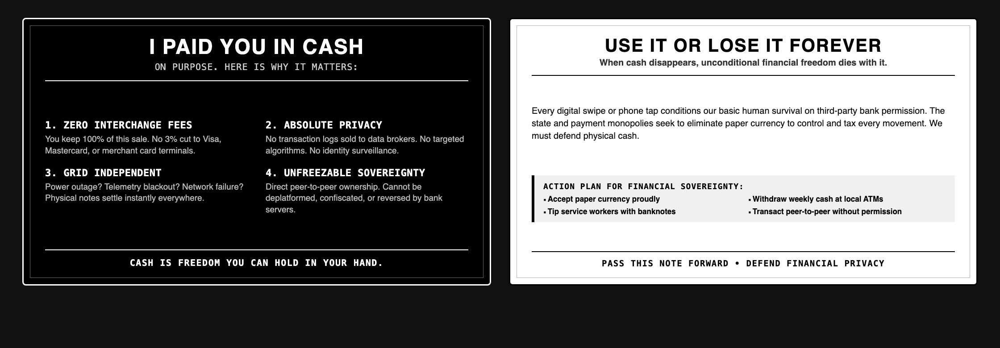

# Physical Cash Sovereignty Handout Card (Standard 3.5" x 2.0" 300 DPI Monochrome)

A print-ready, high-contrast, black-and-white business card handout designed to accompany cash transactions at local merchants, cafes, restaurants, and peer-to-peer exchanges.

## Design Specifications
- **Standard Dimensions**: 3.5" x 2.0" (1050 x 600 px at 300 DPI print resolution)
- **Palette**: Strict 100% Monochrome Black & White (No grey shades or gradients that bleed on cheap thermal or toner printers)
- **Front Side (Dark Mode / High Impact)**:
  - Header: *"I Paid You In Cash. On purpose. Here is why it matters."*
  - 4 Structural Pillars:
    1. Zero 3% Interchange Extortion (merchant keeps 100% of the sale)
    2. Absolute Privacy (no broker logs, no targeted tracking)
    3. Grid Independence (settles offline during blackouts or network crashes)
    4. Unfreezable Sovereignty (unconditional peer-to-peer ownership)
  - Footer: *"CASH IS FREEDOM YOU CAN HOLD IN YOUR HAND."*
- **Back Side (Light Mode / Actionable Defense)**:
  - Header: *"Use It Or Lose It Forever — When cash disappears, financial freedom dies with it."*
  - Context: Explains how digital transaction monopolies centralize control and eliminate financial privacy.
  - Concrete Action Plan:
    - Accept paper currency proudly
    - Withdraw weekly cash from local ATMs
    - Tip service workers with physical banknotes
    - Transact peer-to-peer without third-party permission
  - Footer: *"PASS THIS NOTE FORWARD • DEFEND FINANCIAL PRIVACY"*

## Files in this Deliverable
- `cash_card_showcase.png`: High-resolution side-by-side presentation.
- `cash_card.html`: Self-contained vector HTML template for instant browser print/PDF export.
