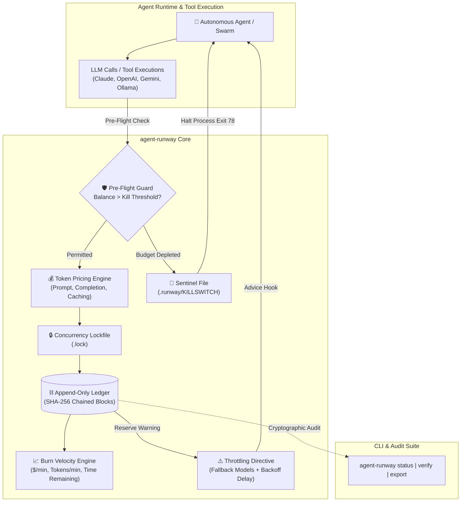

# 🛫 agent-runway

> **Autonomous runtime monitor, ledger auditor, and cost-efficiency toolkit for AI agents.**

[](https://www.npmjs.com/package/agent-runway)
[]()
[]()
[](./LICENSE)
[]()
[](https://github.com/sponsors/rishiicreates)
[](#commercial-licensing--enterprise-support)

---

## ⚡ The Problem

Autonomous AI agents executing iterative reasoning loops can rapidly consume thousands of dollars in minutes when caught in recursion cycles, unexpected error loops, or unbounded tool calls. 

Existing observability tools are passive dashboards that alert you **after** your credit card has been charged.

**`agent-runway` is an active, deterministic safety guard and cryptographic ledger auditor:**
- 🛡️ **Active Pre-Flight Guard:** Intercepts LLM and tool calls **before** they hit provider APIs, immediately aborting execution if budget is exhausted.
- ⛓️ **Cryptographic SHA-256 Ledger:** Maintains a strictly append-only, tamper-evident transaction chain with zero-dependency file locking for parallel multi-agent swarms.
- 🚨 **Autonomous Kill-Switch:** Drops a physical sentinel file (`.runway/KILLSWITCH`) to halt background daemons and exits with code `78` (`EX_CONFIG`).
- ⚠️ **Dynamic Throttling:** Recommends lighter fallback models (e.g. GPT-4o → GPT-4o-mini, Claude 3.5 Sonnet → Haiku) and injects cooling delays when runway enters warning reserves.
- 🔌 **Universal SDK Interceptors:** First-class drop-in wrappers for **Claude (Anthropic)**, **OpenAI**, **Gemini (Google GenAI)**, **Ollama**, and **Model Context Protocol (MCP)** tools.

---

## 🏗️ Architecture



---

## 🚀 Quickstart (CLI)

Install globally or run directly with `npx`:

```bash
npm install -g agent-runway
```

### 1. Initialize Runway
Initialize your agent's budget, kill-switch threshold, and warning buffer:

```bash
# Initialize $25.00 budget with $1.00 hard stop and $5.00 warning threshold
agent-runway init --budget 25.00 --kill-threshold 1.00 --warn-threshold 5.00 --name research-bot
```

### 2. Record Debits (Monetary or Token Usage)
```bash
# Debit by explicit dollar amount
agent-runway debit --amount 0.25 --desc "Web search tool call"

# Debit automatically by model & tokens (accounts for prompt caching discounts)
agent-runway debit --model claude-3-5-sonnet --tokens 12000,1800 --cached 8000
```

### 3. Check Live Dashboard
```bash
agent-runway status
```
Output:
```
=== AGENT RUNWAY MONITOR ===
Agent: research-bot  |  State:  HEALTHY 

--- Balance & Runway ---
  Initial Budget:   $25.00 USD
  Current Balance:  $24.6320 USD
  Total Spent:      $0.3680 USD
  Total Credited:   $25.00 USD

--- Velocity & Burn Rate ---
  Burn Velocity:    $0.0736/min  ($4.42/hr)
  Token Velocity:   2,760 tokens/min
  Time Remaining:   5h 34m
  Tasks Remaining:  ~67 tasks

--- Cumulative Tokens ---
  Prompt Tokens:    12,000
  Output Tokens:    1,800
  Cached Tokens:    8,000
  Total Tokens:     13,800

--- Safety Controls ---
  Kill-Switch:      DISARMED (Normal operation)
  Transactions:     3 entries recorded
```

### 4. Verify Cryptographic Integrity
Audit the entire ledger chain to prove zero tampering, deletion, or balance falsification:

```bash
agent-runway verify
```
```
=== LEDGER CRYPTOGRAPHIC AUDIT ===
Total Transactions: 3
Genesis Hash:       84fa3de129c91b8a...
Latest Hash:        9c2b81014e7a83d4...
Recorded Balance:   $24.632000
Computed Balance:   $24.632000

✔ AUDIT PASSED: All hashes and balances cryptographically verified.
Ledger is immutable, strictly append-only, and tamper-free.
```

### 5. Credit Top-Ups / Bounty Earnings
```bash
agent-runway credit --amount 50.00 --desc "Algora bounty reward deposit"
```

### 6. Export for Financial Reporting
```bash
agent-runway export --format markdown --output audit-report.md
agent-runway export --format csv --output ledger.csv
```

---

## 💻 Programmatic SDK Integration

### OpenAI Interceptor

Wrap your standard OpenAI client. Any `chat.completions.create` call is automatically audited, guarded, and debited:

```typescript
import OpenAI from 'openai';
import { AgentRunway, wrapOpenAI } from 'agent-runway';

const runway = new AgentRunway();
await runway.init({ budget: 15.00, killThreshold: 0.50 });

// Wrap standard client
const openai = wrapOpenAI(new OpenAI(), runway, {
  agentId: 'worker-1',
  preflightCostEstimate: 0.01,
});

// Outbound calls are guarded against runway balance
const completion = await openai.chat.completions.create({
  model: 'gpt-4o',
  messages: [{ role: 'user', content: 'Generate quarterly earnings summary' }],
});

console.log(completion.choices[0].message.content);
// Ledger now contains exact prompt and completion tokens with SHA-256 hash!
```

### Anthropic Claude Interceptor

Includes prompt caching discount calculation:

```typescript
import Anthropic from '@anthropic-ai/sdk';
import { AgentRunway, wrapAnthropic } from 'agent-runway';

const runway = new AgentRunway();
const anthropic = wrapAnthropic(new Anthropic(), runway);

const message = await anthropic.messages.create({
  model: 'claude-3-5-sonnet-20241022',
  max_tokens: 1024,
  messages: [{ role: 'user', content: 'Audit this smart contract code' }],
});
```

### Google Gemini Interceptor

```typescript
import { GoogleGenerativeAI } from '@google/generative-ai';
import { AgentRunway, wrapGemini } from 'agent-runway';

const runway = new AgentRunway();
const genAI = new GoogleGenerativeAI(process.env.GEMINI_API_KEY!);
const model = wrapGemini(genAI.getGenerativeModel({ model: 'gemini-1.5-pro' }), runway);

const result = await model.generateContent('Analyze market trends');
```

### Ollama / Local Compute Models

Track local token generation at zero cost or apply a custom hardware compute depreciation rate:

```typescript
import { Ollama } from 'ollama';
import { AgentRunway, wrapOllama } from 'agent-runway';

const runway = new AgentRunway();
const ollama = wrapOllama(new Ollama(), runway, {
  costPer1MPrompt: 0.05, // Optional custom electricity/hardware rate
  costPer1MCompletion: 0.10,
});

await ollama.chat({
  model: 'llama3.2',
  messages: [{ role: 'user', content: 'Summarize text' }],
});
```

### Generic Tool & MCP Interceptors

Wrap external tool executions (web scraping, database queries, code interpreters):

```typescript
import { AgentRunway, trackToolExecution } from 'agent-runway';

const runway = new AgentRunway();

const searchResult = await trackToolExecution(
  runway,
  'serp_api_search',
  { query: 'quantum computing hardware' },
  async () => {
    return await fetchSearchAPI('quantum computing hardware');
  },
  { estimatedCost: 0.015, agentId: 'researcher' }
);
```

---

## 🔒 Cryptographic Ledger Architecture

Every recorded entry forms an immutable hash-chained block:

$$\text{Hash}_n = \text{SHA-256}\left(\text{Index}_n \,\|\, \text{Timestamp}_n \,\|\, \text{Type}_n \,\|\, \text{Amount}_n \,\|\, \text{Balance}_n \,\|\, \text{Model}_n \,\|\, \text{Tokens}_n \,\|\, \text{PrevHash}_{n-1}\right)$$

1. **Genesis Verification:** Block #0 must point to `0000000000000000000000000000000000000000000000000000000000000000`.
2. **Sequential Chaining:** Block $n$ `prevHash` must strictly match Block $n-1$ `hash`.
3. **Deterministic Canonicalization:** Normalizes tokens, costs, models, and metadata to eliminate JSON whitespace discrepancies.
4. **Accounting Invariant:** $\text{Balance}_n = \text{Balance}_{n-1} + \text{Amount}_n$ checked to 6 decimal places. Any unauthorized alteration or file splicing immediately fails `agent-runway verify`.

---

## ⚙️ CLI Command Reference

| Command | Options | Description |
| :--- | :--- | :--- |
| `init` | `-b, --budget`, `-k, --kill-threshold`, `-w, --warn-threshold`, `-n, --name`, `-f, --force` | Initializes runway ledger and configuration |
| `debit` | `-a, --amount`, `-m, --model`, `-t, --tokens`, `--cached`, `--desc`, `--agent`, `--tool` | Deducts cost or token usage against runway |
| `credit` | `-a, --amount` (required), `--desc`, `--agent` | Deposits funds, top-ups, or bounty rewards |
| `status` | `-j, --json`, `-w, --watch` | Displays live burn rate, velocity, and health |
| `verify` | `-j, --json` | Cryptographically audits hash chain & balances |
| `export` | `-f, --format <json\|csv\|markdown>`, `-o, --output <file>` | Exports ledger records to stdout or file |
| `pricing` | `[model]`, `-j, --json` | Inspects rates across 17+ model configurations |

---

## 🧪 Testing & Verification

`agent-runway` is built with test-driven rigor:
- **70 automated tests across 10 test suites** (Unit, Concurrency, Integrations, CLI E2E).
- **>96% line, function, and statement coverage**.

```bash
# Run tests
npm test

# Run tests with coverage report
npm run test:coverage
```

---

## 📦 Publishing & Deployment

`agent-runway` is configured for publication to the npm registry:

```bash
# Build TypeScript to dist/
npm run build

# Run prepublish validation
npm run prepublishOnly

# Publish to npm
npm publish --access public
```

---

## 💼 Commercial Licensing & Enterprise Support

`agent-runway` is open-sourced under the **MIT License** for individual developers and open-source projects.

For enterprises deploying commercial AI agent fleets, we offer:
- **Commercial Closed-Source Redistribution License**
- **Centralized Multi-Agent Cloud Ledger Sync & Team Dashboard**
- **SOC-2 & Enterprise Compliance Audit Packages**
- **Dedicated SLA & Custom Model Pricing Integrations**

For licensing inquiries, contact: **[rishiicreates@gmail.com](mailto:rishiicreates@gmail.com)** or sponsor via [GitHub Sponsors](https://github.com/sponsors/rishiicreates).

---

© 2026 Hrishikesh Yadav (Rishii). All rights reserved.
