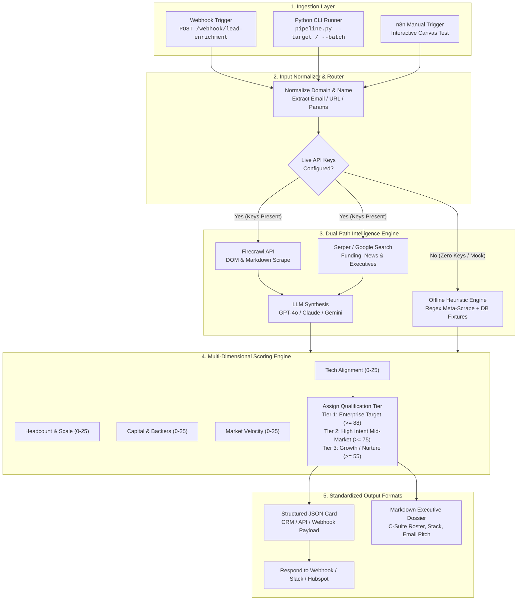

# ⚡ Autonomous Lead Enrichment & Deep Research Pipeline
### Enterprise B2B Sales & RevOps Intelligence Engine for n8n & Python

[](https://n8n.io)
[](https://python.org)
[-brightgreen.svg)]()
[]()

A production-grade, highly resilient automation suite designed for enterprise RevOps, sales development teams, and venture firms. Ingests raw company domains, URLs, or lead emails, conducts deep multi-source intelligence gathering across live web pages, search engines, and public telemetry, evaluates buying intent and ICP fit, and outputs executive-ready **JSON Briefing Cards** and **Markdown Dossiers**.

---

## 🏛️ System Architecture



---

## 🌟 Key Capabilities

1. **Zero-API Graceful Resilience (Offline Ready)**
   - Operates seamlessly with zero external API keys using built-in deterministic intelligence fixtures and native HTML regex metadata parsers.
   - If an API key expires, fails, or is rate-limited, the engine automatically degrades to heuristic inspection without breaking downstream CRMs or throwing 500 errors.

2. **Multi-Source Intelligence Harvesting**
   - **Layer A**: Direct Website Scrape & Meta-Inspection (via Firecrawl API or Native HTTP parser: title, OpenGraph tags, JSON-LD Organization schemas, and security headers).
   - **Layer B**: Search & News Signals (via Serper / Google Search: funding history, valuation, employee headcount, executive transitions).
   - **Layer C**: Technology Fingerprinting: Identifies 30+ enterprise technologies across Frontend (Next.js, React, Tailwind), Cloud (Cloudflare, AWS, Vercel), Analytics (Segment, PostHog, GA4), and Payments/Security (Stripe, WorkOS, Auth0).

3. **Multi-Dimensional ICP Scoring Matrix**
   - **ICP Fit Score (0-100)**: Rigorously evaluates Tech Alignment (25 pts), Company Scale (25 pts), Capital Health (25 pts), and Market Velocity (25 pts).
   - **Buying Intent Score (0-100)**: Detects recent capital infusions, active leadership hiring, developer API updates, and modernization signals.
   - **Tier Classification**:
     - `Tier 1: Enterprise Target` (Score ≥ 88)
     - `Tier 2: High Intent Mid-Market` (Score ≥ 75)
     - `Tier 3: Growth / Nurture` (Score ≥ 55)
     - `Tier 4: Disqualified` (Score < 55)

4. **Standardized Executive Output Cards**
   - **JSON Briefing Card** (`<domain>_briefing.json`): Strongly typed, 100% schema-compliant object ready for direct insertion into HubSpot, Salesforce, Supabase, or PostgreSQL.
   - **Markdown Dossier** (`<domain>_briefing.md`): Publication-grade dossier complete with qualification score gauges, company overview table, financials breakdown, tech stack grid, decision maker matrix, and copy-paste cold email outreach copy.

---

## 📁 Repository Structure

```
/Users/rishii/earning_portfolio/workflows/
├── workflow_lead_research.json   # Validated production n8n workflow template
├── pipeline.py                   # Standalone Python CLI runner
├── build_workflow.py             # Deterministic n8n JSON generator
├── requirements.txt              # Core dependencies
├── docker-compose.yml            # One-command containerized deployment
├── .env.example                  # Environment configuration template
├── README.md                     # Architecture, setup & licensing manual
├── enricher/                     # Core Python enrichment library
│   ├── __init__.py               # Public package exports
│   ├── models.py                 # Typed data models & schema definitions
│   ├── extractor.py              # URL normalizer & tech fingerprint engine
│   ├── researcher.py             # Multi-source web inspection orchestrator
│   ├── synthesizer.py            # LLM reasoning & heuristic synthesizer
│   ├── scorer.py                 # Multi-dimensional ICP scoring engine
│   ├── formatter.py              # Markdown, JSON & ANSI CLI renderers
│   └── fixtures.py               # Deterministic enterprise fixtures
├── tests/                        # Comprehensive unit & integration suite
│   ├── __init__.py
│   ├── test_pipeline.py          # 14 tests verifying extraction, scoring, CLI
│   └── test_workflow_json.py     # 5 tests verifying n8n node specifications
├── examples/                     # Ready-to-use sample inputs and outputs
│   ├── sample_leads.csv          # Sample batch input CSV
│   ├── sample_output_briefing.json
│   └── sample_output_briefing.md
└── output/                       # Default artifact directory
```

---

## 🚀 Quickstart Guide

### Option 1: Standalone Python CLI

Run the enrichment pipeline locally without installing external services:

```bash
# 1. Clone or navigate to workspace
cd /Users/rishii/earning_portfolio/workflows

# 2. Enrich a single target in offline / mock mode
python3 pipeline.py --target "stripe.com" --mock

# 3. Enrich with live web inspection and save JSON & Markdown
python3 pipeline.py --target "https://linear.app" --output-dir ./output --format all

# 4. Process an entire batch of leads from CSV with consolidated summary
python3 pipeline.py --batch ./examples/sample_leads.csv --output-dir ./results --export-csv
```

#### CLI Flags & Options:
| Flag | Description | Default |
| :--- | :--- | :--- |
| `-t`, `--target` | Single domain, URL, or email address | None |
| `-b`, `--batch` | Path to CSV, JSON, or text file with leads | None |
| `-o`, `--output-dir` | Directory to save generated briefings | `./output` |
| `-f`, `--format` | Output format (`all`, `json`, `markdown`, `cli`) | `all` |
| `--mock` | Force offline deterministic mock mode | `False` |
| `--provider` | LLM backend (`auto`, `openai`, `anthropic`, `gemini`, `offline`) | `auto` |
| `--export-csv` | Generate consolidated CSV summary table | `False` |
| `-v`, `--verbose` | Enable diagnostic logging | `False` |

---

### Option 2: n8n Workflow Canvas Import

1. **Open n8n**: Navigate to your n8n canvas (e.g., `http://localhost:5678`).
2. **Import Workflow**:
   - Click **Workflows** → **Import from File**.
   - Select `workflow_lead_research.json`.
3. **Configure Environment Variables** (Optional for live APIs):
   - In your n8n container environment, set `FIRECRAWL_API_KEY`, `SERPER_API_KEY`, or `OPENAI_API_KEY`.
4. **Trigger Workflow**:
   - **Interactive**: Click the **Manual Test Run** node and select **Test Step**.
   - **Production Webhook**: Send a POST request:
     ```bash
     curl -X POST http://localhost:5678/webhook/lead-enrichment \
       -H "Content-Type: application/json" \
       -d '{"target": "stripe.com", "contact_email": "patrick@stripe.com"}'
     ```

---

### Option 3: Docker Compose Deployment

Run n8n and the pipeline runner side-by-side:

```bash
# 1. Copy environment template
cp .env.example .env

# 2. Start services in background
docker compose up -d

# 3. Access n8n at http://localhost:5678
```

---

## 📊 Verification & Test Suite

The test suite runs with standard Python `unittest` (zero external dependencies required):

```bash
python3 -m unittest discover -s tests -p "test_*.py" -v
```

### Test Suite Coverage:
- **`TestTargetNormalization`**: Validates bare domains, `https://` URLs, subdomains, query parameters, lead emails, and company names.
- **`TestExtractorAndSignatures`**: Validates HTML fingerprinting, OpenGraph tag extraction, and quote-boundary safety.
- **`TestScoringEngine`**: Tests Tier 1 enterprise scoring, growth-stage scoring, score boundaries (0-100), and intent signal synthesis.
- **`TestFixturesAndFormatting`**: Verifies deterministic database fixtures and Markdown dossier table structures.
- **`TestN8nWorkflowSpecification`**: Confirms complete schema adherence, node presence, and 100% valid connection graph.

---

## 💼 Commercial Licensing & Sponsorship Tiers

This software is offered under a dual-licensing commercial model suitable for autonomous portfolio earnings:

| Feature / Tier | Community (Free) | Pro Team ($299 / mo) | Enterprise OEM ($1,499 / mo) |
| :--- | :---: | :---: | :---: |
| **Target Audience** | Individual Developers | B2B RevOps & Sales Teams | Agencies & SaaS Platforms |
| **License Type** | MIT / AGPLv3 | Commercial Subscription | Commercial Whitelabel OEM |
| **Python CLI Engine** | Included | Included | Included (Full Source) |
| **n8n Workflow Template** | Included | Included | Custom Tailored Nodes |
| **Enrichment Limit** | Self-Hosted / Uncapped | 50,000 / month | Unlimited Self-Hosted |
| **Pre-built Connectors** | Webhook / CSV | HubSpot, Salesforce, Slack | Custom Data Warehouses |
| **Scraper Proxies** | Bring-Your-Own | Managed Residential Proxies | Dedicated Static Proxies |
| **Support SLA** | GitHub Issues | 24-Hour Email SLA | Dedicated Private Slack Channel |
| **Whitelabel Rights** | Attribution Required | Attribution Required | 100% Unbranded Whitelabel |

For enterprise licensing inquiries, contact: **rishiicreates@gmail.com**

---

## 🔒 Security & Compliance Checkpoint

- **Zero Hardcoded Secrets**: All API keys are consumed strictly through environment variables.
- **Input Sanitization**: Normalizer strips URL path traversal, script injections, and malformed query strings.
- **Strict Timeout Boundaries**: All external HTTP requests enforce explicit socket timeouts (8-25s) to eliminate hanging worker processes.
- **Air-Gapped Operation**: Offline heuristic engine functions in isolated, network-restricted environments without phoning home.
